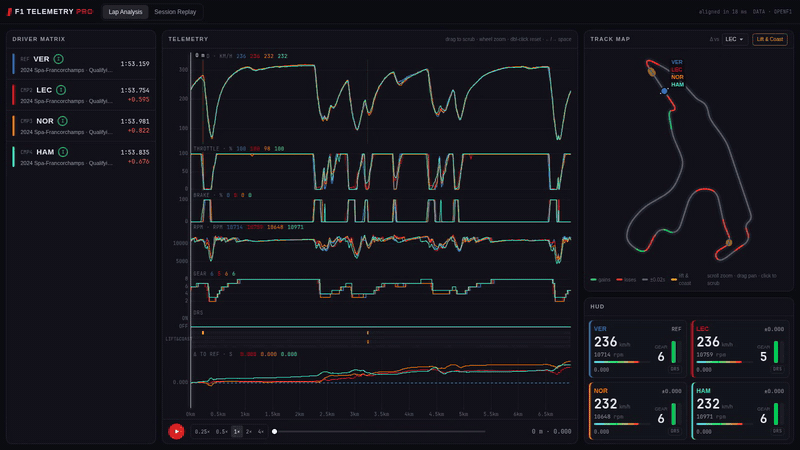
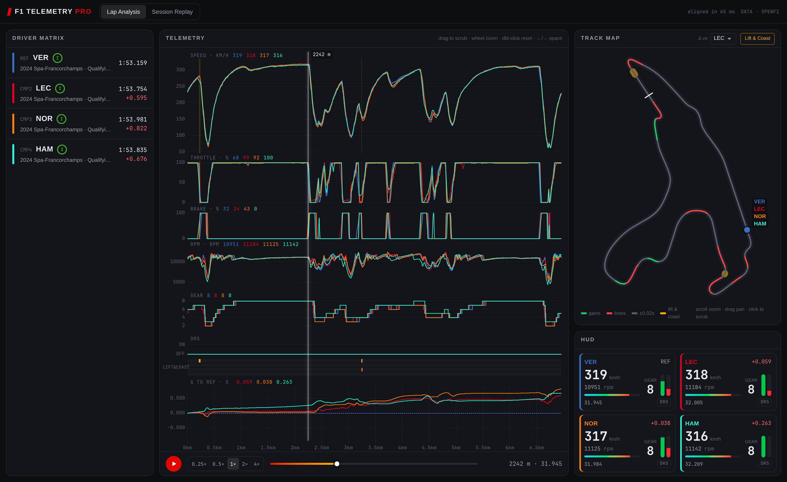
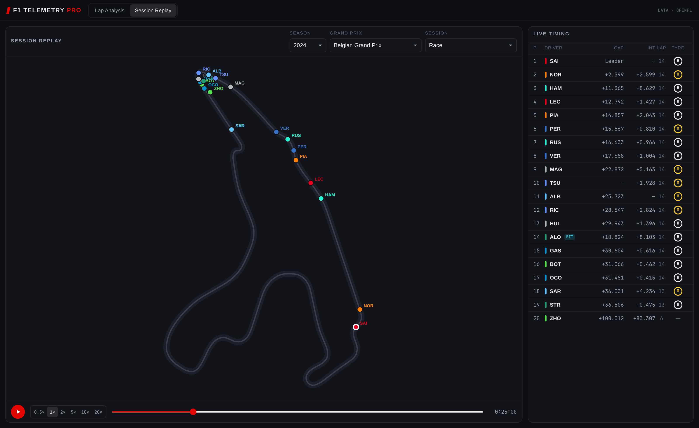

<p align="center">
  <h1 align="center">F1 Telemetry Pro</h1>
</p>

<p align="center">
  <strong>Client-side Formula 1 telemetry analysis and session replay built on real FIA timing data from OpenF1. Four-driver lap overlays, track delta maps, lift &amp; coast detection, and 60 FPS scrubbing in the browser. No backend, accounts, or tracking.</strong>
</p>

<p align="center">
  <a href="https://f1-telemetry-pro.vercel.app"></a>
  
  
  
  
  
  
  
</p>

---

> **The Problem:** Comparing F1 laps usually means Python notebooks, plotting the same channels by hand, and re-downloading the same session data every time.
>
> **The Result:** Pick up to four drivers, laps, sessions, or seasons. Speed, throttle, brake, RPM, gear, DRS, and time delta all line up on one distance axis, with a single scrub needle driving every chart, the track map, and the HUD. Every response is cached in IndexedDB, so a reload makes zero network requests.

---

<p align="center">
  
</p>



## Features

| Area | Capability |
| :--- | :--- |
| **Real race weekend data** | Seasons 2023+ from the [OpenF1](https://openf1.org) REST API: meetings, sessions, drivers, laps, stints, `car_data`, `location`, positions, intervals, pit stops. Nothing is mocked or synthesised. |
| **4-driver comparison matrix** | Slot 1 is the reference; slots 2–4 are comparisons. Each slot independently picks **season, Grand Prix, session, driver, lap** (fastest or a specific lap) and **tyre compound**, so 2023 vs 2024 Spa or Q3 vs race lap 20 both work. |
| **Synchronised scrubbing** | One master scrub position drives the needle across 7 uPlot channels, per-chart value readouts, car dots on the track map, the HUD gauges, and the lap scrubber. Drag, wheel-zoom, keyboard (`←/→`, `Shift` for 100 m, `Space` to play) or click the map. |
| **Distance-aligned channels** | Distance comes from trapezoidal integration of speed over time. Every lap is resampled onto a shared 5 m grid so corners line up across drivers. |
| **Track delta map** | Circuit drawn from the reference lap's `location` stream. 100 m micro-sectors are coloured **green** (comparison gains), **red** (loses) or **grey** (within ±0.02 s). Pan, zoom, click-to-scrub. |
| **Lift &amp; coast detection** | `throttle = 0 ∧ brake = 0 ∧ speed > 150 km/h` held for ≥ 150 ms. Shown as amber/cyan bands on the charts, a per-driver lane, and highlighted track segments. |
| **Lap playback** | Real-time playback driven by the reference lap's own clock at 0.25×–4×. |
| **Session replay** | Whole-session playback at 0.5×–20× with every car interpolated on the map, plus a live timing tower: position, gap to leader, interval, lap, compound, and pit status. |
| **Persistent cache** | In-memory LRU → IndexedDB → network. Lap telemetry is keyed `session_key:driver_number:lap_number` and never refetched. |
| **Rate-limit aware** | Requests go through a queue that respects OpenF1's free tier (3 req/s, 30 req/min). The budget is persisted in `localStorage` and shared across tabs with Web Locks, so reloads and second tabs can't trip a `429`. |



## Performance

Measured with Playwright in headless Chrome 155 (1680×1000), against live OpenF1 data and the production deployment:

| Metric | Result |
| :--- | :--- |
| Lap scrubbing (4 drivers, 7 channels, map, HUD) | **60.0 FPS**: 719 frames, 0 frames over 20 ms, 0 long tasks |
| Session replay at 20× (20 cars) | **60.0 FPS** |
| Cold load, 4 laps aligned | ~7–8 s (18 requests, bounded by the API rate limit) |
| Warm reload | **~130–370 ms, 0 network requests** |
| Worker alignment of 4 laps | ~40–65 ms, off the main thread |
| `429 Too Many Requests` during cold load → replay | **0** |

How it stays smooth:

- **No React renders while scrubbing.** The scrub position lives in a small event bus outside React. Listeners write straight to canvas and DOM, coalesced to one update per animation frame.
- **Canvas, not DOM nodes.** Charts use uPlot and the track map uses Canvas2D. No SVG elements per sample.
- **Partial overlay clears.** Car markers erase only the rectangles they drew last frame, so per-frame raster work scales with the markers, not the canvas size.
- **Own compositor layers** for text that changes every frame, so readouts never force the charts underneath to repaint.
- **Web Worker** for lap cleaning, distance integration, grid alignment, delta and lift & coast detection. Results come back as transferable `Float64Array`s.

## Getting started

```bash
npm install
npm run dev        # http://localhost:5173
```

| Script | What it does |
| :--- | :--- |
| `npm run dev` | Vite dev server |
| `npm run build` | Type check + production bundle to `dist/` |
| `npm run lint` | ESLint (`strictTypeChecked`, `no-explicit-any`) + `tsc --noEmit`, zero warnings allowed |
| `npm test` | Vitest unit suite (46 tests, including real recorded OpenF1 laps) |
| `npm run test:live` | Integration test against the live OpenF1 API (2023 Monza qualifying) |
| `node scripts/record-fixture.mjs <session_key> <driver> [lap]` | Record a real lap as a test fixture |

No environment variables or API keys are needed. OpenF1 historical data is free and unauthenticated.

### Deploy to Vercel

```bash
npx vercel login
npx vercel --prod
```

Vite is auto-detected (build `npm run build`, output `dist/`). It's a static SPA, so there are no server functions or environment variables.

## Architecture

```
 OpenF1 REST API (api.openf1.org/v1)
        │  3 req/s · 30 req/min
        ▼
 ┌──────────────────────────────────────────────────────────────┐
 │ src/api      RequestQueue ── shared rate ledger (localStorage│
 │              + Web Locks), 429 backoff, 404 → [], dedupe      │
 │              OpenF1Client ── memory LRU → IndexedDB → network │
 └──────────────┬───────────────────────────────────────────────┘
                │ RawLapTelemetry (car_data + location per lap)
                ▼
 ┌──────────────────────────────────────────────────────────────┐
 │ src/workers  telemetry.worker: clean → integrate distance →  │
 │              align on 5 m grid → Δt → lift & coast zones      │
 └──────────────┬───────────────────────────────────────────────┘
                │ AlignedComparison (transferable Float64Arrays)
                ▼
 ┌───────────────────────┐        ┌─────────────────────────────┐
 │ zustand stores        │        │ scrubBus (outside React)    │
 │ slots · view · result │        │ rAF-coalesced scrub head    │
 └──────────┬────────────┘        └──────────────┬──────────────┘
            │ renders on data change only        │ every frame
            ▼                                    ▼
   Driver matrix · panels        uPlot needle · track map overlay · HUD · scrubber
```

The maths (integration, grid alignment, delta, micro-sectors, lift & coast, replay interpolation) is written up in [`docs/telemetry-math.md`](docs/telemetry-math.md). Endpoint usage, cache keys, and OpenF1 field quirks are in [`docs/openf1-api-specs.md`](docs/openf1-api-specs.md).

## Project structure

```
F1-nodaysidle/
├── docs/
│   ├── openf1-api-specs.md        # endpoints, rate limits, cache keys, field quirks
│   ├── telemetry-math.md          # distance integration, alignment, delta, L&C
│   └── screenshots/
├── scripts/record-fixture.mjs     # capture a real OpenF1 lap for tests
├── src/
│   ├── api/                       # OpenF1 client, rate-limited queue, shared rate ledger
│   ├── cache/                     # IndexedDB store + in-memory LRU
│   ├── workers/                   # lap alignment worker, pure align core, typed RPC
│   ├── store/                     # zustand: slots/view (persisted), telemetry result
│   ├── hooks/                     # scrub bus, comparison loader, async helper
│   ├── components/
│   │   ├── common/                # panels, selects, compound badges
│   │   ├── session-picker/        # season / Grand Prix / session
│   │   ├── driver-matrix/         # 4-slot comparison drawer
│   │   ├── charts/                # uPlot channel stack, lap scrubber
│   │   ├── track-map/             # canvas circuit, delta colouring, car markers
│   │   ├── replay/                # replay engine, map, timing tower
│   │   └── hud/                   # per-driver live gauges
│   ├── utils/                     # distance, interpolation, delta, lift-coast, colours, laps
│   ├── types/                     # OpenF1 payloads, telemetry contracts
│   └── test/fixtures/             # real recorded laps (2024 Spa qualifying)
├── AGENTS.md                      # engineering contract for AI coding agents
└── vite.config.ts
```

## Data notes

- `brake` arrives as 0/100 or 0–100 depending on the car and is normalised to [0, 1]. `throttle` values above 100 are clamped.
- DRS codes 10/12/14 mean the flap is open; 0/1/8 mean closed or eligible.
- Integrated lap distance is within ~1% of the official circuit length (Spa: 6957 m vs 7004 m). Comparison laps are stretched to the reference length so corners line up.
- The final Δt equals the official lap-time gap exactly, because both clocks end at their `lap_duration`.

## License

[MIT](LICENSE) © 2026 nodaysidle

## Credits

Data from [OpenF1](https://openf1.org), an open-source API for Formula 1 timing data. This project isn't affiliated with Formula 1, the FIA, or any team. F1, FORMULA ONE and related marks are trademarks of Formula One Licensing B.V.
